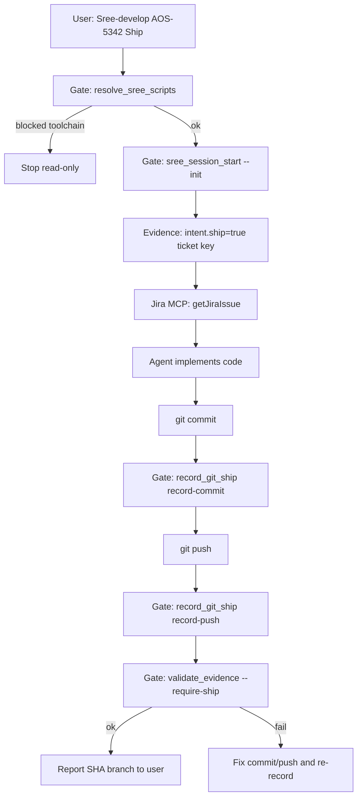

# Sree-develop — implementation guide

Simple overview of **flow**, **gates**, and **evidence**, including the **Ship** keyword.

---

## What problem this solves

| Problem | Without gates/evidence | With gates/evidence |
|--------|-------------------------|---------------------|
| Agent skips steps | Chat says “done” but no push | Scripts record what actually happened |
| Tampered scripts | Anyone edits a gate script | `manifest.json` hash check → **blocked** |
| Audit / compliance | No machine-readable trail | `.cursor/sree-develop-evidence.json` |
| “Ship” ambiguous | Unclear if push required | `intent.ship: true` in evidence |

**Gate** = a small Python script that **passes or blocks** the next step.  
**Evidence** = a local JSON **notebook** updated by gates (never committed to git).

---

## Keywords in the user message

Example:

```text
Sree-develop AOS-5342 Ship
```

| Part | Meaning |
|------|--------|
| `Sree-develop` / `/sree-develop` | Run this skill |
| `AOS-5342` | Jira ticket key |
| **`Ship`** | **Must** commit and push to GitHub after implementation |

Without **`Ship`**, profile is `implement_only` (code OK; push optional unless user asks).

---

## End-to-end flow



---

## Gate scripts (what each does)

| Order | Script | Purpose |
|-------|--------|--------|
| 1 | `resolve_sree_scripts.py --json` | Find scripts; verify `manifest.json` hashes |
| 2 | `sree_session_start.py --init --text "..."` | Start session; set ticket + **Ship** intent |
| 3 | *(agent)* Jira MCP | Fetch ticket (not a Python gate) |
| 4 | *(agent)* `git commit` | Create commit |
| 5 | `record_git_ship.py record-commit --json` | Write commit SHA/branch to evidence |
| 6 | *(agent)* `git push` | Push to GitHub |
| 7 | `record_git_ship.py record-push --json` | Set `git.pushed: true` in evidence |
| 8 | `validate_evidence.py --require-ship --json` | Fail if Ship promised but push not recorded |
| optional | `record_git_ship.py check-ship` | Same check as step 8 |

Set script path once:

```powershell
$env:SREE_SCRIPTS = "C:\path\to\skills\sree-develop\scripts"
```

Run gates from the **product repo root** (the app you are changing), not only the plugin repo.

---

## Evidence file

**Path:** `.cursor/sree-develop-evidence.json` (local only; gitignored)

**Important fields after a Ship session:**

```json
{
  "intent": { "ship": true },
  "ship_profile": "full",
  "ticket": { "key": "AOS-5342" },
  "git": {
    "commit_sha": "abc123...",
    "feature_branch": "feature/aos-5342",
    "pushed": true
  },
  "workflow_stage": 4,
  "status": "partial"
}
```

`status: complete` is reserved for a future closeout (PR/CI). Ship flow still uses **`partial`** but with push recorded.

Schema: `schemas/sree-develop-evidence.schema.json`

---

## Why gates are needed

1. **Trust** — The LLM can forget steps; gates enforce “record commit before claiming Ship.”
2. **Integrity** — Manifest hashes detect changed scripts without updating `build_manifest.py`.
3. **Resume** — Evidence shows how far the session got after a crash or compacted chat.
4. **Compliance** — Auditors read JSON, not chat logs.

---

## Why evidence is needed

1. **Proof** — Shows session started, ticket key, Ship intent, commit SHA, push flag.
2. **No secrets** — Only SHAs and branch names; never API keys.
3. **Validation** — `validate_evidence.py --require-ship` turns “Ship” into a checkable contract.

---

## After editing Python gates

```powershell
python skills/sree-develop/scripts/build_manifest.py
```

Commit the updated `manifest.json` or gates will fail with hash mismatch.

---

## Related docs

- `references/toolchain-layer1.md` — script lookup order
- `references/evidence-bundle.md` — evidence rules
- `SKILL.md` — agent instructions (must match this flow)
